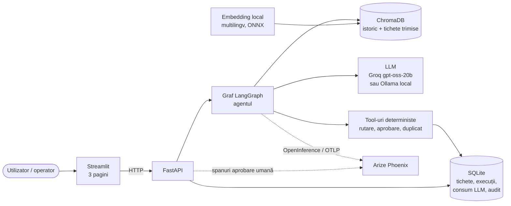
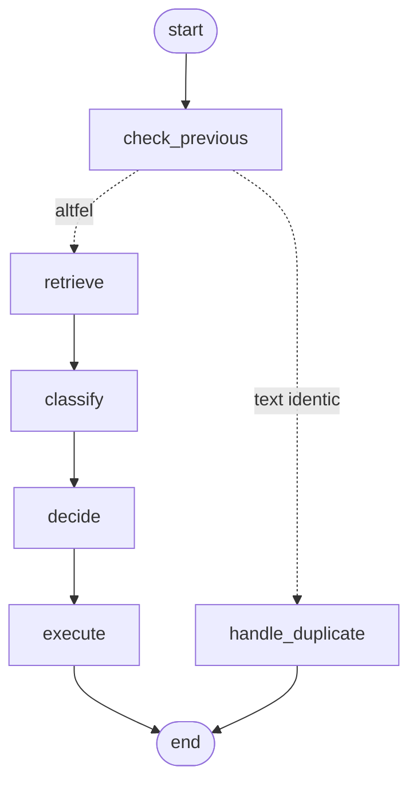
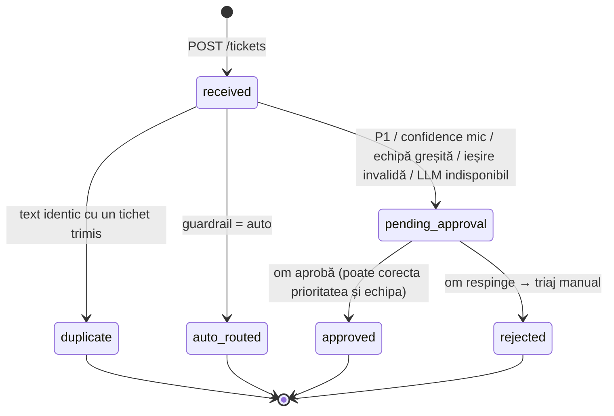
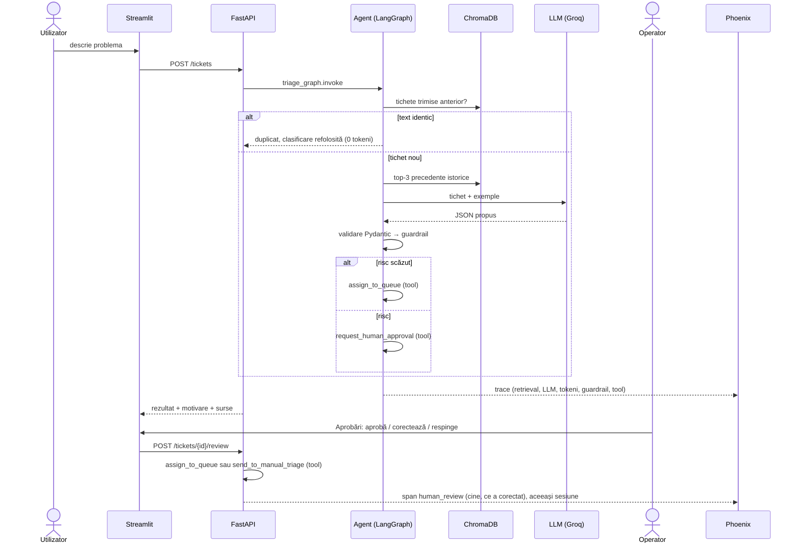
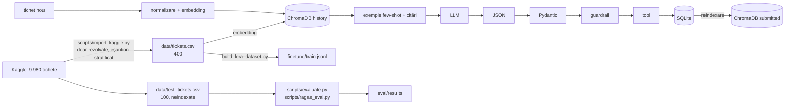

# Arhitectură

Agentul primește un tichet IT în text liber (română sau engleză), propune prioritatea
(P1–P4), categoria și echipa, pe baza tichetelor istorice similare, apoi decide: rutare
automată sau aprobare umană. Tot ce decide și tot ce execută rămâne în baza de date și în
Arize Phoenix.

Principiul de bază: **LLM-ul doar propune**. Propunerea e un JSON validat cu Pydantic.
Decizia o ia cod determinist (guardrail), iar execuția trece numai prin tool-uri cu
validări. LLM-ul nu are acces la nicio acțiune.

## Componente

| Componentă | Tehnologie | Rol |
|---|---|---|
| Interfață | Streamlit | Clasificare, Aprobări, KPI & FinOps. Vorbește doar cu API-ul. |
| Backend | FastAPI | `POST /tickets`, `POST /tickets/{id}/review`, `GET /approvals`, `GET /kpis`, … (docs la `/docs`) |
| Orchestrare | LangGraph (LangChain) | Graful agentului: noduri, stare, tranziții |
| Retrieval | ChromaDB + retrievere LangChain | Precedente istorice și tichete trimise anterior |
| Embedding | fastembed, `paraphrase-multilingual-MiniLM-L12-v2` | Local, gratuit, RO↔EN |
| LLM | Groq `openai/gpt-oss-20b` (free tier) · Ollama (local) | Propune clasificarea |
| Validare | Pydantic | Contractul LLM → sistem |
| Persistență | SQLite | Sursa de adevăr; indexul Chroma se reconstruiește din ea |
| Observabilitate | Arize Phoenix, OpenTelemetry/OpenInference | Trace pe fiecare tichet, grupat pe sesiune |

## Graful agentului (LangGraph)

Generat direct din cod (`triage_graph.get_graph().draw_mermaid()`):

## Roluri (noduri)

| Nod | Rol | LLM? | Ce face |
|---|---|---|---|
| `check_previous` | Detectare duplicate | nu | Caută în tichetele trimise anterior (RAG). Text identic după normalizare → duplicat. Similar (distanță ≤ 0.35) → exemplu. |
| `handle_duplicate` | Reutilizare | nu | Refolosește clasificarea tichetului original. 0 tokeni. |
| `retrieve` | Retriever | nu | Top-3 tichete istorice similare: context, exemple few-shot, citări. |
| `classify` | Clasificator | **da** | Propune JSON-ul, care trece prin validarea Pydantic. La JSON invalid, o singură reîncercare cu eroarea inclusă. |
| `decide` | Guardrail | nu | Aplică regulile de risc, în ordine. |
| `execute` | Executor | nu | Singurul nod care schimbă starea sistemului, și doar prin tool-uri. |

Aprobarea umană e al doilea punct de execuție, în afara grafului
(`service.review_ticket`). Omul aprobă, corectează sau respinge, iar execuția trece prin
aceleași tool-uri.

## Tool-uri (execuție deterministă)

Tool-uri LangChain (`agent/tools.py`), fiecare cu validări. În Phoenix apar ca spanuri `TOOL`.

| Tool | Cine îl apelează | Validări | Efect |
|---|---|---|---|
| `assign_to_queue` | `execute` (automat) sau aprobarea umană | echipa există în taxonomie; tichetul e în stare validă | înregistrare în `assignments` + audit |
| `request_human_approval` | `execute` | tichetul e nou | status `pending_approval` + audit cu regula |
| `link_duplicate` | `handle_duplicate` | originalul există | audit |
| `send_to_manual_triage` | aprobarea umană (respins) | tichetul e în așteptare | coada „Service Desk (triaj manual)” + audit |

## Stare și handoff-uri

Starea care trece de la un nod la altul (`TriageState`):

| Câmp | Produs de | Folosit de |
|---|---|---|
| `ticket_id`, `text`, `force_new` | API | toate |
| `duplicate`, `previous` | `check_previous` | `handle_duplicate`, `classify` (ca exemple) |
| `similar` (documente + distanțe) | `retrieve` | `classify` |
| `result` (clasificare validată sau eroare, tokeni) | `classify` | `decide`, `execute` |
| `decision` (status, regulă, motiv) | `decide` | `execute` |
| `executed` | `execute` / `handle_duplicate` | răspunsul API |

Ciclul de viață al unui tichet:

## Guardrail: praguri și de ce

Regulile se evaluează în ordine; prima care se aplică decide (`agent/router.py`).

| # | Regulă | Condiție | Rezultat | De ce |
|---|---|---|---|---|
| 1 | `llm_unavailable` | modelul nu răspunde (cheie, rate limit, rețea) | om, triaj manual | tichetul nu se pierde niciodată |
| 1b | `out_of_scope` | distanța top-1 la precedente > 0.65 | om, fără apel LLM | text fără legătură cu IT („mă doare capul”) nu e rutat la nicio echipă |
| 3b | `weak_match` | distanța top-1 între 0.50 și 0.65 | om (LLM propune) | zona gri: și IT în română, și non-IT; omul decide. Calibrat: IT în engleză max 0.454, IT scurt în română 0.12–0.60, non-IT 0.55–0.92 |
| 2 | `invalid_output` | JSON invalid și după reîncercare | om, triaj manual | nu executăm nimic nevalidat |
| 3 | `p1_always_human` | prioritate P1 | om | costul unei greșeli la P1 e maxim; latența omului e acceptabilă față de risc |
| 4 | `low_confidence` | confidence < 0.70 | om | sub prag, modelul însuși semnalează incertitudine (prag ajustabil în `config.py`). Măsurat pe setul de test: confidence-ul gpt-oss-20b e 0.80–0.95 (medie 0.926), deci pragul de 0.70 nu s-a activat niciodată, iar toate cele 19 decizii umane au venit din `p1_always_human`; la llama3.2 confidence-ul e mai împrăștiat (0.2–0.9) și pragul se activează. Calibrarea pragului e un pas următor |
| 5 | `unknown_team` | echipa nu există în taxonomie | om | nu rutăm într-o coadă inexistentă |
| 6 | `team_category_mismatch` | echipa ≠ echipa categoriei | om | propunere inconsistentă internă = semn de eroare |
| 7 | `auto` | altfel | rutare automată | risc scăzut, reversibil prin re-rutare |

Duplicate: reutilizarea automată se face **doar pentru text identic** (după litere mici și
eliminarea punctuației). Distanța de embedding nu e suficientă: „imprimanta de la etajul 2”
și „etajul 3” au distanța 0.04, dar sunt incidente diferite. Textele doar asemănătoare
sunt arătate ca exemplu, nu îmbinate.

## Flux utilizator ↔ AI

## Flux de date

## Observabilitate (Arize Phoenix)

- LangChain/LangGraph sunt instrumentate automat prin OpenInference
  (`openinference-instrumentation-langchain`). Fiecare nod, retriever (cu documentele și
  distanțele), apel LLM (prompt, răspuns, tokeni) și tool devine un span.
- Spanuri adăugate manual: `triage_ticket` (AGENT, rădăcina), `guardrail` (GUARDRAIL:
  input = propunerea LLM, output = decizia și regula), `human_review` (cine, decizie,
  corecții).
- `session.id` = codul tichetului (`INC-0007`). În Phoenix, la **Sessions**, se vede tot
  istoricul unui tichet: clasificarea, decizia, aprobarea și execuția.
- `user.id` = cine a trimis sau a aprobat.
- Tracer-ul nu e global, ca FastAPI să nu trimită spanuri HTTP (de exemplu `/health` la 10 secunde).
- Dacă Phoenix nu rulează, aplicația merge normal.
